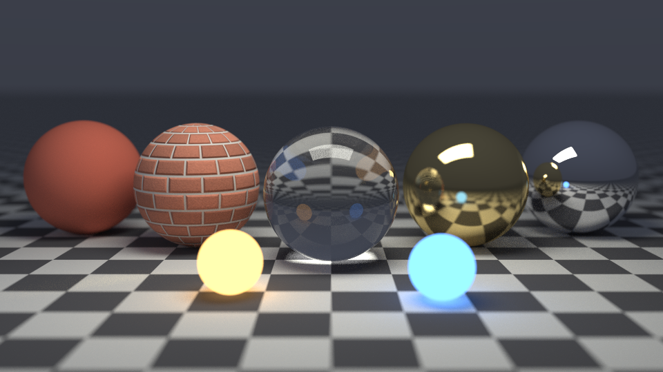
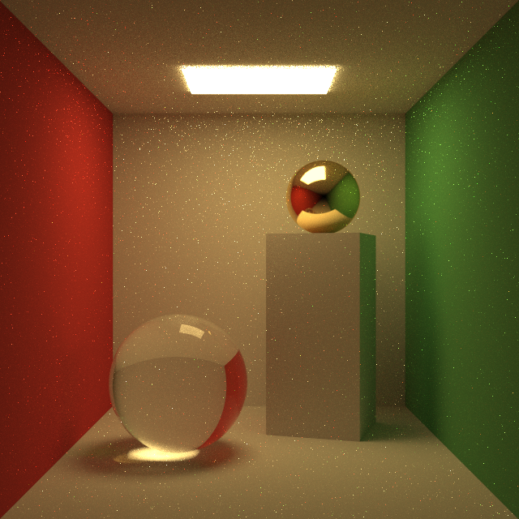
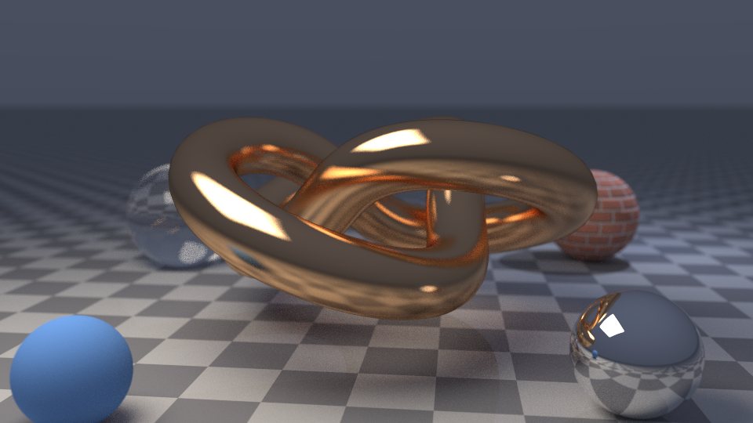
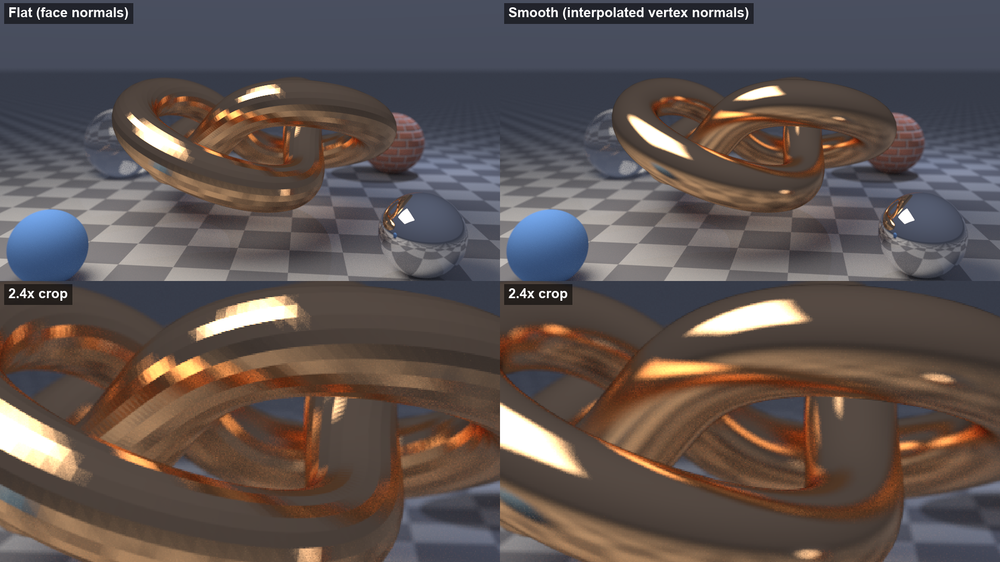

# C++ Path Tracer

A CPU Monte Carlo path tracer in C++17. It renders JSON scene files either to an image from the
command line or progressively in a GLFW window with a free-fly camera.

It started from Peter Shirley's *Ray Tracing in One Weekend* series (camera, the `scatter()`
material interface, Lambertian/metal/dielectric materials and the sampling helpers follow the
books closely), and extends it with the features listed under "Beyond the book" below.



## Features

What is implemented, and where:

- **Integrator** (`src/rendering/integrator.cpp`): iterative path tracing with next-event
  estimation (one shadow-ray sample per light at each diffuse hit, BRDF albedo/pi), emission
  counted only where NEE did not already account for it, Russian roulette after 3 bounces, and a
  configurable background gradient.
- **Materials** (`src/materials/`): Lambertian (cosine-weighted bounce), textured Lambertian with an
  optional tangent-space normal map, metal with fuzz, dielectric (Snell refraction, total internal
  reflection, Schlick Fresnel), emissive.
- **Geometry** (`src/geometry/`): spheres, infinite planes, triangles (Moller-Trumbore), and
  Wavefront OBJ meshes loaded as triangles, flat or smooth shaded. Smooth shading interpolates
  per-vertex normals (the file's `vn`, or area-weighted face averages) with the hit's barycentric
  coordinates; the geometric normal is kept for front/back-face decisions.
- **Lights** (`src/core/light.cpp`): point lights and rectangular area lights; area lights can be
  given visible geometry.
- **Acceleration** (`src/acceleration/`): bounding volume hierarchy built with a 16-bin surface
  area heuristic (a midpoint split is available for comparison), stored as a flat node array and
  traversed iteratively, near child first. Infinite planes are tested outside the BVH.
- **Camera**: vertical field of view, thin-lens depth of field (aperture, focus distance).
- **Textures**: checker, image (stb_image), normal map.
- **Parallelism**: `#pragma omp parallel for schedule(dynamic)` over image rows when built with
  OpenMP, with a `thread_local` PCG32 generator reseeded per pixel, so images do not depend on the
  thread count. Without OpenMP the same code runs single-threaded.
- **Output**: PNG (built-in writer, no zlib) or binary PPM, gamma 2.2 and clamping (no tone
  mapping).
- **Viewer** (`src/main.cpp`, `src/viewer/`): GLFW window that accumulates one sample per pixel per
  frame, WASD/QE + right mouse to fly, accumulation resets when the camera moves.

### Beyond the book

Planes and Moller-Trumbore triangles, OBJ loading with smooth shading, JSON scenes, point and area lights with
next-event estimation, normal mapping with per-primitive tangent frames, a binned-SAH flat BVH with
a brute-force equivalence test and a benchmark, OpenMP rendering with deterministic per-pixel RNG
streams, Russian roulette, a headless CLI with progressive snapshots, a dependency-free PNG writer,
the interactive progressive viewer, and a WebAssembly build.

## Renders

| | |
|---|---|
|  |  |
| Cornell box: diffuse walls with colour bleeding, glass sphere, gold sphere, visible area light. 640x640, 1024 spp. The remaining bright speckles are caustic paths (wall, then glass or metal, then light), which this integrator finds only by chance (no MIS). | 17,280-triangle torus knot in the BVH, smooth shaded, brushed copper (fuzz 0.15); glass, mirror and normal-mapped brick spheres, depth of field. 960x540, 512 spp. Copper speckles on the floor are caustics (floor, then metal, then light). |

The materials scene at the top shows Lambertian, normal-mapped brick, glass, gold and chrome
spheres, two emissive spheres, a checker floor and depth of field (960x540, 1024 spp).
`renders/progressive.mp4` shows one view converging from 1 to 256 samples per pixel.

Flat vs smooth shading of the same knot (left: face normals, right: interpolated vertex normals):



Bug fixes on this branch, with before/after renders and the maths behind each one, are written up
in [docs/FIXES.md](docs/FIXES.md).

## BVH performance

`bvh_bench` (in `tests/`) casts a 128x128 grid of camera rays at a bumpy sphere tessellated into
more and more triangles. Brute force tests every triangle for every ray; on big meshes it runs on a
subset of the same rays and its hits are checked against the BVH. Raw output: `renders/bvh_timing.txt`.

Measured on an Intel Core i5-14400F under Windows 11, single thread, WebAssembly (wasm32-wasi,
zig 0.16 / clang 21, `-O2`) running in Node 24.20. Native builds will be faster; the ratios are the
point.

| Triangles | SAH build (ms) | BVH nodes | BVH, SAH (Mrays/s) | BVH, midpoint (Mrays/s) | Brute force (Mrays/s) | Speed-up, SAH vs brute force |
|---:|---:|---:|---:|---:|---:|---:|
| 128 | 0.7 | 123 | 8.02 | 8.42 | 0.971 | 8x |
| 1,058 | 1.4 | 1,125 | 5.34 | 3.95 | 0.0814 | 66x |
| 8,192 | 14.7 | 8,805 | 3.06 | 2.83 | 0.00982 | 311x |
| 32,768 | 48.5 | 35,681 | 2.86 | 2.24 | 0.00238 | 1,202x |
| 131,072 | 244 | 142,811 | 1.70 | 1.55 | 0.00048 | 3,513x |
| 524,288 | 1,071 | 570,307 | 1.54 | 1.39 | 0.00013 | 11,585x |

Brute force used 16,384 rays up to 8,192 triangles, then 12,207 / 3,051 / 762 rays; its hit
distances matched the BVH's for every ray. End to end, `hero_knot.json` (17,287 objects,
smooth-shaded knot) at 320x180 and 4 spp rendered in 0.44 s with the BVH and 111.0 s with
`--no-bvh` (about 250x), and the two output files were byte-identical. (The earlier flat, gold
version of the scene: 0.48 s vs 158.7 s.)

## Building

### CMake (native)

Dependencies: CMake 3.16+ and a C++17 compiler. GLM is vendored in `third_party/glm` (used when no
system GLM is found). GLFW and OpenGL are only needed for the viewer; OpenMP is optional.

```bash
cmake -S . -B build -DCMAKE_BUILD_TYPE=Release
cmake --build build --config Release
ctest --test-dir build -C Release        # BVH vs brute force, smooth normals
```

Targets:

- `raytracer_cli`: headless renderer, always built
- `raytracer`: GLFW viewer, built only when GLFW and OpenGL are found
- `bvh_test`, `smooth_normals_test` (both run by `ctest`), `bvh_bench`

On macOS: `brew install cmake glfw` (and `libomp` for OpenMP). On Windows with vcpkg:
`vcpkg install glfw3` and pass `-DCMAKE_TOOLCHAIN_FILE=<vcpkg>/scripts/buildsystems/vcpkg.cmake`.

### WebAssembly (no native toolchain)

`tools/wasi/build.sh` compiles the CLI, test and benchmark to wasm32-wasi with `zig c++`, and
`tools/wasi/run.mjs` runs them with Node's built-in WASI. WASI has no OpenMP or C++ exception
runtime, so these builds are single-threaded and an error prints its message and aborts.

```bash
ZIG_CXX="zig c++" tools/wasi/build.sh
node tools/wasi/run.mjs build-wasm/bvh_test.wasm
node tools/wasi/run.mjs build-wasm/raytracer_cli.wasm --scene scenes/hero_cornell.json \
     --width 640 --height 640 --spp 256 --out cornell.png
```

Run from the repository root: scene files refer to textures and meshes by relative path.

## Usage

```
raytracer_cli --scene FILE.json [options]
  --out FILE           output image, .png or .ppm (default out.png)
  --width N --height N image size (default 640x360); the camera's aspect follows it
  --spp N              samples per pixel (default 64)
  --depth N            max path length (default 50)
  --seed N             RNG seed (default 0)
  --rr N               Russian roulette after N bounces, 0 = off (default 3)
  --no-bvh             brute-force intersection
  --bvh-split sah|middle
  --threads N          OpenMP threads
  --snapshots pow2|all --snapshot-prefix P
                       also save the accumulated image after every (power-of-two) sample count
```

Viewer: `./build/bin/raytracer [scene_index]` with scene index 0-4 (the scene gallery in
`src/core/scene_gallery.cpp`). Controls: WASD move, Q/E up/down, right mouse drag to look, R reset,
P save a PPM screenshot, Esc quit.

## Scene format

```json
{
  "camera": { "position": [0, 1, 3.3], "look_at": [0, 1, 0], "vup": [0, 1, 0], "vfov": 37,
              "aperture": 0.0, "focus_distance": 3.3 },
  "background": { "top": [0.3, 0.36, 0.5], "bottom": [0.05, 0.04, 0.05] },
  "objects": [
    { "type": "sphere", "center": [0, 0.5, 0], "radius": 0.5,
      "material": { "type": "dielectric", "ir": 1.5 } },
    { "type": "plane", "point": [0, 0, 0], "normal": [0, 1, 0],
      "material": { "type": "lambertian", "albedo": [0.7, 0.7, 0.7] } },
    { "type": "obj", "file": "assets/models/torus_knot.obj", "scale": 1, "translate": [0, 1, 0],
      "smooth": true, "material": { "type": "metal", "albedo": [0.92, 0.56, 0.3], "fuzz": 0.15 } }
  ],
  "lights": [
    { "type": "area", "center": [0, 1.98, -1], "u": [0.8, 0, 0], "v": [0, 0, 0.6],
      "emission": [8.5, 6, 2], "visible": true },
    { "type": "point", "position": [3, 2.5, -3], "intensity": [6, 7, 10] }
  ]
}
```

- Primitives: `sphere`, `plane`, `triangle` (`v0`, `v1`, `v2`), `obj` (`file`, `scale`,
  `translate`, `smooth`: true for interpolated vertex normals, default false).
- Materials: `lambertian` (`albedo` or `texture`), `textured_lambertian` (`albedo_texture`,
  optional `normal_map`, `normal_strength`), `metal` (`albedo`, `fuzz`), `dielectric` (`ir`),
  `emissive` (`emission`). A texture is an image path or
  `{"type": "checker", "color1", "color2", "frequency"}`.
- Area lights: `center` is the middle of the rectangle, `u` and `v` its full edges. Emission is
  two-sided. `"visible": true` adds emissive geometry for the camera, mirrors and glass.
- `background` is a colour or a top/bottom gradient (default white to sky blue).

Scenes in `scenes/`: `hero_materials`, `hero_cornell`, `hero_knot`, `rng_bias_demo`,
`normal_map_spheres`, and the original `cornell_box`, `glass_showcase`, `material_test`,
`normal_map_demo` (checker textures only, no normal map), `textured_spheres`.
The brick textures and the torus knot are generated by `tools/gen_textures.py` and
`tools/gen_mesh.py`.

## Project structure

```
src/
  core/          ray, camera, scene, lights, JSON loader, RNG and helpers
  geometry/      sphere, plane, triangle (mesh.cpp is an unfinished stub)
  materials/     Lambertian, textured Lambertian, metal, dielectric, emissive
  textures/      image, checker, normal map
  acceleration/  AABB and BVH
  rendering/     integrator, renderer, progressive renderer, framebuffer, image writers
  cli/           headless renderer
  viewer/        GLFW window and camera controls
tests/           bvh_test, smooth_normals_test (correctness), bvh_bench (timing)
scenes/          JSON scenes
assets/          generated textures and mesh
tools/           texture/mesh generators, WebAssembly build
third_party/glm  GLM 1.0.1
external/        nlohmann/json, stb_image, glad
docs/FIXES.md    bug-fix notes
renders/         images and video
```

## Limitations

- No multiple importance sampling: caustics and small emitters that are not lights are noisy.
- `Mesh` is a stub (OBJ files load as individual triangles); OBJ UVs are ignored. Smooth shading
  can show the usual "shadow terminator" darkening on very coarse meshes.
- Planes and spheres use different bitangent orientations, so normal maps on planes have their
  green channel flipped.
- The viewer uses a fixed default camera instead of the scene file's camera.
- No tone mapping beyond gamma 2.2 and clamping.
- The viewer and the OpenMP build were not run on the machine used for this branch (renders and
  timings come from the single-threaded WebAssembly build).

## License

This project is for educational and portfolio purposes. Third-party code: GLM (MIT,
`third_party/glm/glm/copying.txt`), nlohmann/json (MIT), stb_image (public domain / MIT), glad.
