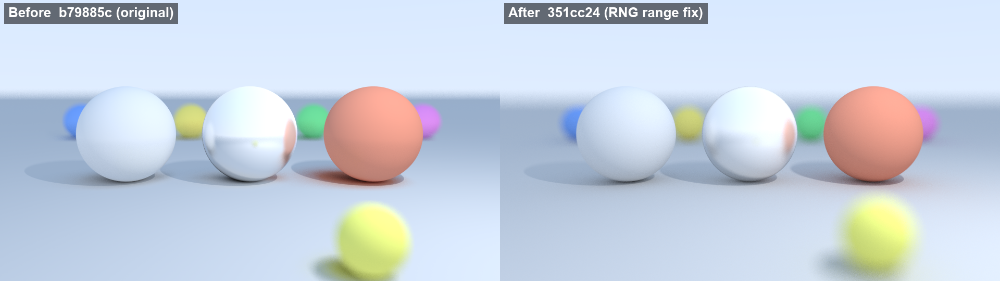
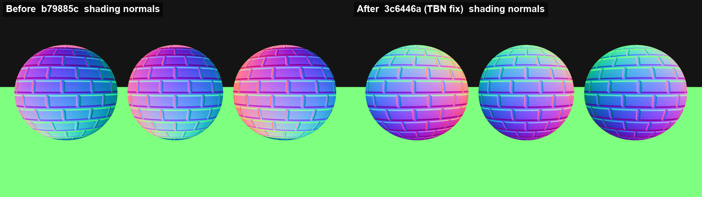
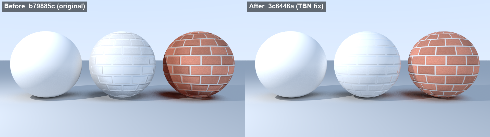
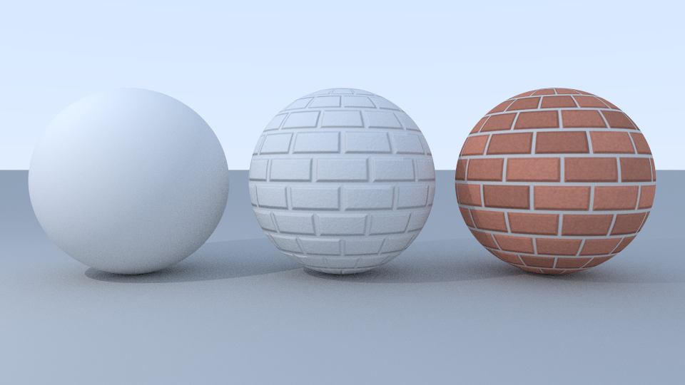
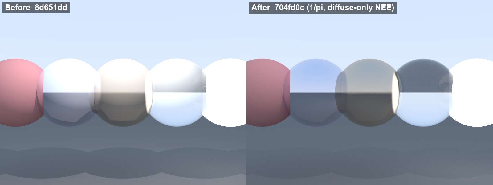

# Fixes and additions: study notes

These notes go through every bug fixed on the `portfolio-fixes` branch and every feature that was
claimed in the old README but missing from the code. For each bug they cover what was wrong, why it
produced the artifact you can see, the fix, and the maths behind it, so you can explain it in an
interview without notes.

The code base started from Peter Shirley's *Ray Tracing in One Weekend* series (the camera,
materials, `scatter()` interface, `random_in_unit_sphere()` and the original BVH stub follow the
books closely). Say that up front if asked; then talk about what you changed and why.

All renders in this file come from the headless renderer compiled to wasm32-wasi and run under
Node (single thread). "Before" images come from the original commit `b79885c` (or from the parent
of the fix commit, where stated). Old commits only had the GLFW viewer, so they were rendered with
a small driver that calls their own `SceneLoader`, `Camera`, `Renderer` and `Framebuffer`; only
their file I/O was swapped from `<fstream>` to C stdio so they build for WASI. The rendering code
is untouched.

Commits, oldest first:

| Commit | Change |
|---|---|
| `3c6446a` | Fix transposed TBN matrix in normal mapping |
| `351cc24` | Fix random_float/random_int ignoring their range after the first call |
| `8d651dd` | Sample area lights on a rectangle centred on 'center' |
| `704fd0c` | Fix direct lighting: add the 1/pi BRDF factor, apply it only to diffuse surfaces |
| `f615451` | Make the integrator iterative and stop double counting light-sampled emitters |
| `ab74a56` | Add Russian roulette path termination |
| `c1ddbc5` | Implement a binned-SAH BVH and use it for scene intersection |
| `42267be` | Parallelize rendering with OpenMP and give each thread its own RNG |

---

## 1. The random number range was frozen by a `static` distribution

**File:** `src/core/utils.cpp`

**What was wrong**

```cpp
float random_float(float min, float max) {
    static std::uniform_real_distribution<float> distribution(min, max);
    static std::mt19937 generator;
    return distribution(generator);
}
```

A function-local `static` is initialised once, the first time control passes through it. The
distribution object stores its range, so it keeps the `min`/`max` of the first call forever. The
first call in a render is `random_float()` for pixel jitter, so the range was frozen at [0, 1).
Every later `random_float(-1, 1)` silently returned [0, 1). `random_int` had the same problem.

**Why it is visible**

Three things are built from `random_float(-1, 1)` through rejection sampling:

- `random_in_unit_sphere()` only produced points with x, y, z >= 0 (one octant of the ball).
- `random_in_unit_disk()` only produced points with x, y >= 0 (a quarter disk).
- `random_unit_vector()` (normalised sphere sample) only pointed into the + + + octant.

Consequences:

- **Diffuse bounces.** The Lambertian bounce is `n + random_unit_vector()`. Adding a uniform unit
  vector to the normal gives a cosine-weighted direction (pdf cos(theta)/pi), but only if the unit
  vector is uniform over the whole sphere. With one octant, every bounce leans toward +x+y+z, so
  indirect light (the sky, colour bleeding, contact shadows) comes from one side only.
- **Metal fuzz.** `reflect + fuzz * random_in_unit_sphere()` only spread the reflection over 1/8
  of the ball, always tilted the same way. Fuzzy metal looked almost like a sharp, slightly shifted
  mirror.
- **Depth of field.** The lens offset `lens_radius * random_in_unit_disk()` only covered a quarter of
  the aperture. Out-of-focus objects were blurred by a quarter-disk kernel (a quarter of the blur
  area) whose centre is offset from the pixel, so they look sharper than they should and slightly
  displaced.

**Fix:** keep only the engine persistent and apply the range on every call:

```cpp
float unit = (rng.next() >> 8) * (1.0f / 16777216.0f);   // 24 random bits -> [0, 1)
return min + (max - min) * unit;
```

Using 24 bits means every value is exactly representable as a float, so the result can never round
up to `max`. (`42267be` later moved the engine to a `thread_local` PCG32; see section 8.)

**Maths to quote:** if U is uniform on [0, 1), then a + (b - a)U is uniform on [a, b). A uniform
point on the unit sphere added to the normal gives directions with pdf cos(theta)/pi, which is
exactly the Lambertian importance-sampling pdf, so the weight BRDF * cos / pdf = (rho/pi) cos /
(cos/pi) = rho. That identity only holds when the sphere sample really is uniform.

**Before / after** (`b79885c` vs `351cc24`, `scenes/rng_bias_demo.json`, 960x540, 256 spp):



Look at the fuzzy metal sphere (sharp before, properly blurred after), the far coloured spheres and
the horizon (only partly blurred before), and the near yellow sphere (displaced, smaller blur).

---

## 2. The TBN matrix was transposed

**File:** `src/textures/normal_map.cpp`

**What was wrong**

```cpp
glm::mat3 tbn_matrix(
    rec.tangent.x, rec.bitangent.x, rec.normal.x,
    rec.tangent.y, rec.bitangent.y, rec.normal.y,
    rec.tangent.z, rec.bitangent.z, rec.normal.z);
```

GLM matrices are column-major: the nine-float constructor fills column 0 first. So the first three
numbers (T.x, B.x, N.x) became column 0, and the matrix's *rows* were T, B and N. The matrix you
need to go from tangent space to world space has T, B and N as its *columns*:

    world = TBN * (x, y, z) = x*T + y*B + z*N

The code built the transpose. For an orthonormal basis the transpose is the inverse, so it applied
the world-to-tangent transform instead.

**Why it is visible**

Even a flat texel (0, 0, 1) should map to N, but it came out as (T.z, B.z, N.z), a direction that
depends on how the tangent frame is oriented in the world rather than on the surface. Shading
normals point the wrong way, sometimes below the surface, and the bricks' bevels are lit from the
wrong side.

**Fix:** `glm::mat3 tbn_matrix(rec.tangent, rec.bitangent, rec.normal);` (three column vectors).

**How to explain it:** "GLM, like GLSL, is column-major. The 9-float constructor takes columns, so
writing the matrix out row by row on paper and typing it in gives you the transpose."

**Before / after** (`b79885c` vs `3c6446a`, `scenes/normal_map_spheres.json`)

Shading-normal debug view (colour = 0.5 * (n + 1); the floor is not normal-mapped). After the fix,
the top of every sphere is green (+y), its right side red (+x) and the side facing the camera blue
(+z), with the brick bevels on top. Before the fix the colours do not match the sphere's
orientation:



Shaded render of the same commits. In the original code the normal map only affected bounce rays
(direct light used the geometric normal, see section 4), so the difference is less obvious here
than in the debug view:



With all fixes (direct light now uses the normal-mapped normal too):



---

## 3. Area lights were offset by half their size

**File:** `src/core/light.cpp`

**What was wrong:** `AreaLight` stores `center`, `u` and `v`, but sampled
`center + s*u + t*v` with s, t in [0, 1). That covers the rectangle from `center` to
`center + u + v`, so the light was shifted by (u + v) / 2 from where the scene file placed it.

**Fix:** s, t in [-0.5, 0.5), so `center` is the centre and `u`, `v` are the full edge vectors.
The pdf does not change: the area |u x v| is the same.

**Visible effect:** in `scenes/cornell_box.json` (u = v = 0.3) the light moved by 0.15 in x and z,
so shadows and the light patch on the ceiling move to where the file says the light is.

---

## 4. Direct lighting: missing 1/pi, and applied to metal and glass

**File:** `src/rendering/integrator.cpp`

**What was wrong**

```cpp
// Lambertian BRDF: albedo / pi * cos(theta)
direct += sample.radiance * cos_theta / sample.pdf;
...
return emitted + attenuation * direct + indirect;
```

1. The comment says albedo / pi but the code never divides by pi.
2. `direct` was added for every material whose `scatter()` returns true, including mirrors, fuzzy
   metal and glass.
3. It used the geometric normal, so normal maps did not affect direct light.

**The maths.** Next-event estimation estimates the direct part of the rendering equation

    L_o = integral over the light of f(wi, wo) * L_e * cos(theta_i) dw

with one light sample of solid-angle pdf p:

    L_o ~= f * L_e * cos(theta_i) / p

For a Lambertian surface f = albedo / pi. For an area light sampled uniformly by area,
p = d^2 / (A * cos(theta_light)). For a point light of intensity I there is no pdf: the
contribution is (albedo/pi) * I * cos(theta) / d^2.

The old code computed albedo * L * cos / p, which is **pi times too bright** for direct light.

For a perfect mirror or glass, f is a delta function: light arrives only from the single reflected
or refracted direction. The chance that a light sample lands exactly on that direction is zero, so
the correct NEE contribution is 0; their light has to come from the scattered ray. Adding a
Lambertian-style term made glass and chrome look partly matte.

**Fix**

- `Material::diffuse_brdf(rec, albedo, shading_normal)` returns true only for Lambertian and
  textured Lambertian, and gives the albedo and the (normal-mapped) shading normal.
- `direct_lighting` evaluates `(albedo / pi) * L * cos / pdf` for those materials only, skipping
  lights behind the shading normal or behind the real surface.
- Mirror, glass and fuzzy metal get no NEE term (fuzzy metal is not a delta lobe, but this code has
  no metal BRDF to evaluate, so it relies on its scattered ray).

**Visible effect:** direct-lit diffuse surfaces get about 1/pi as bright (that is correct; the
shipped scenes were tuned with the bug, so they now look darker), and glass/metal lose the false
matte shading.

**Before / after** (`8d651dd` vs `704fd0c`, `scenes/material_test.json`):



---

## 5. Double counting of lights (latent in the shipped scenes)

**File:** `src/rendering/integrator.cpp`

**What was wrong:** at every diffuse hit the integrator (a) sampled the lights with shadow rays
(NEE) and (b) followed a cosine-sampled bounce ray and added the emission of whatever it hit. If an
emitter is both scene geometry *and* a sampled `Light`, the light reaching that diffuse point is
counted once by (a) and again by (b). Expected brightness from that light doubles.

**Does it show up?** Not in the shipped JSON scenes. Area lights there have no geometry (bounce rays
cannot hit them), and no emissive object is also registered as a light, so no emitter is counted by
both paths. It does apply to `SceneBuilder::create_cornell_box()` (an emissive sphere plus an area
light at the same spot), which nothing currently calls, and to any scene that gives a light visible
geometry. No before/after image is shown because there is no shipped scene where it changes pixels.

**Standard fix (NEE without MIS)**

- After a diffuse vertex that did NEE, ignore the emission of light-sampled emitters that the
  bounce ray hits; NEE already counted them.
- Count emission on camera rays and after mirror, glass and fuzzy-metal bounces, where no NEE
  happened.
- Always count emitters that are *not* registered lights (for example the glowing spheres in
  `hero_materials.json`), since only bounce rays can find them.

The integrator became a loop with a path throughput and a `count_light_emission` flag.
`Emissive` now records whether it is the geometry of a sampled light, and area lights accept
`"visible": true` in JSON, which adds two emissive triangles flagged that way. That is how the
hero scenes show their light panels (and their reflections in mirrors and glass) without counting
them twice.

**Why not MIS?** Multiple importance sampling would weight both strategies instead of switching one
off. It reduces noise for glossy surfaces and big lights, but it needs BRDF pdfs for every material.
The flag approach is the textbook first step and is unbiased.

---

## 6. Russian roulette (claimed in the README, was missing)

After `rr_start` bounces (default 3), the path continues with probability

    p = min(max(throughput.r, throughput.g, throughput.b), 0.95)

and if it continues, the throughput is divided by p. Why it is unbiased: if X is the path's
remaining contribution, the new estimator is X/p with probability p and 0 otherwise, so
E = p * (X/p) + (1 - p) * 0 = X. Paths that can only add a little light (low throughput) are
stopped early, which saves time without changing the expected image. The cap at 0.95 stops
very bright paths from running forever; `max_depth` stays as a hard limit.

---

## 7. BVH (claimed, was a stub)

**What was there:** `BVHNode::hit()` returned false, no bounding boxes were computed,
`box_compare()` returned false, the constructor copied the object vector at every level, and the
class was never used. Every ray tested every object.

**What it is now** (`src/acceleration/bvh.*`)

- Every bounded primitive returns an AABB (`Primitive::bounding_box`). Planes are infinite, so they
  stay in a small list that is tested linearly.
- **Build:** top-down. For each node, compute the bounds of the primitive centroids; for each axis,
  drop the centroids into 16 bins; for each of the 15 bin boundaries, compute the
  surface area heuristic

      cost = C_trav + (A_L * N_L + A_R * N_R) / A_node * C_isect

  where A is surface area and N primitive count (C_trav = C_isect = 1). A_L / A_node is the
  probability that a ray which hits the node also hits the left box (for uniformly distributed
  rays), so the cost is the expected work for one ray. Pick the cheapest split; make a leaf if
  splitting is not cheaper than testing all N primitives (leaves hold at most 4). If the partition
  degenerates, fall back to a median split. A midpoint split is kept for comparison.
- **Layout:** one flat `std::vector<Node>`; the two children of a node are adjacent, so a node only
  stores one index. Primitives are reordered so a leaf is a contiguous range.
- **Traversal:** iterative with a fixed stack. The slab test clips the ray against the current
  closest hit, and the child nearer along the ray (chosen from the sign of the ray direction on the
  split axis) is visited first, so far boxes are often culled.

**Proof it is correct:** `tests/bvh_test.cpp` builds random scenes (triangles of mixed sizes,
spheres, axis-aligned triangles, a plane) and fires 200,000 rays, including rays that start inside
the scene and rays with a finite `t_max` like shadow rays. For both SAH and midpoint builds, BVH and
brute force must agree on hit/miss, hit distance and which primitive was hit. Result: 0 mismatches.

**Timing:** see the table in the README (`bvh_bench`). Headline numbers (single thread, wasm):
at 1,058 triangles the SAH BVH casts rays 66x faster than brute force, at 131,072 triangles
3,513x faster. A full render of the 17,285-object knot scene at 320x180, 4 spp took 0.48 s with
the BVH and 158.7 s without, and both runs wrote byte-identical images. SAH beats the midpoint
split by 8-35% on these meshes, except the 128-triangle one where the midpoint tree is slightly faster.

Why SAH: the midpoint split only looks at where centroids are; SAH also counts how big the
children's boxes get, so it avoids splits that leave two large overlapping boxes.

---

## 8. OpenMP and per-thread random numbers (claimed, was missing)

CMake found OpenMP and added `-fopenmp`, but no loop used it. Now the row loops in `Renderer` and
`ProgressiveRenderer` (and the CLI's progressive mode) have

```cpp
#if defined(_OPENMP)
#pragma omp parallel for schedule(dynamic, 1)
#endif
```

- `schedule(dynamic, 1)`: rows that hit glass and metal take longer than sky rows, so threads take
  one row at a time instead of fixed blocks.
- The single `static std::mt19937` would have been a data race. The engine is now a `thread_local`
  PCG32, and it is reseeded for every pixel (and every progressive pass) from a hash of
  (x, y, pass, seed). Every pixel therefore gets the same random numbers whatever thread renders
  it, so images are identical for any thread count.
- The `#if` guard keeps compilers without OpenMP (MSVC without `/openmp`, wasm32-wasi) on the plain
  loop, without unknown-pragma warnings.

The renders here were made single-threaded in WebAssembly, so the speed-up was not measured on this
machine; the OpenMP path was only compiled (clang `-fopenmp`, x86-64 Linux target) to check that
it builds.

---

## 9. Known remaining issues

- `Mesh::hit` is still a TODO (OBJ files load as individual triangles instead), and triangles are
  flat shaded.
- The GLFW viewer's `SceneGallery` ignores the camera in the scene file and uses a fixed default
  camera. The viewer was not rebuilt or run on this branch (no GLFW/MSVC on the machine used).
- Tangent frames are not consistent between primitives: on spheres the bitangent points toward -v
  (image up, OpenGL-style normal maps), on planes toward +v. Normal maps on planes have their green
  channel flipped.
- `ImageTexture` clamps UVs instead of wrapping them, and its raw-data constructor allocates with
  `new[]` while the destructor calls `stbi_image_free` (which uses `free`).
- No MIS, so caustics (diffuse -> glass -> light) and small bright emitters that are not lights
  produce fireflies at low sample counts.
- The shipped scenes were tuned with the pi-too-bright direct light and now render darker.
